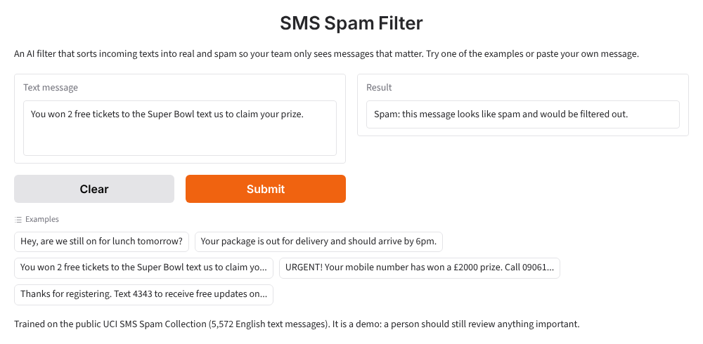

# SMS Spam Filter

An AI filter that sorts incoming texts into real and spam so your team only sees messages that matter.



## Results

The model was tested on 1,839 text messages it never saw during training (a third of the dataset, held back).

| Measure | Result |
| --- | --- |
| Overall accuracy | **99.0%** (1,820 of 1,839 correct) |
| Spam caught | 95.1% (234 of 246 spam messages) |
| Real messages wrongly flagged as spam | 0.4% (7 of 1,593) |
| Spam that got through | 12 messages |

For comparison, a "filter" that let everything through would score 86.6%, because most texts are real.

**Duplicate check.** The dataset contains 403 exact duplicate messages, so some test messages also
appear in the training data. After removing duplicates and retraining, accuracy is **98.5%**
(5-fold cross-validation average: 98.5%). The result holds up without the duplicates.

**What it gets wrong**

- **Missed spam** usually sounds like a friend: flirty or chatty messages ("Hello darling how are
  you today?"), jokes, and spam with no obvious words like *free*, *win* or *claim*.
  It also labels "You are a lucky winner of $5000!" as real. Spam in this dataset usually asks
  you to text or call a number, so a scam without one can slip through.
- **False alarms** are short, casual real messages, especially ones that mention calls, texts,
  chat or being free ("No calls..messages..missed calls", "Are you free now?can i call now?").

To reproduce these numbers and print every misclassified message, run `python spam_filter.py`.

## How to run the app

You need Python 3.11 (the version it was tested on).

```bash
git clone https://github.com/gordon-laraven/sms_spam_detector.git
cd sms_spam_detector
python -m venv .venv
source .venv/bin/activate        # Windows: .venv\Scripts\activate
pip install -r requirements.txt
python app.py
```

Open the address it prints (usually http://127.0.0.1:7860), paste a text message, and click **Submit**.

To retrain the model and save a new `model/spam_filter.joblib`:

```bash
python spam_filter.py
```

To see how it works step by step, open
[`gradio_sms_text_classification.ipynb`](gradio_sms_text_classification.ipynb).

## What this means for a client

Spam filtering is one example of a broader job: **sorting incoming messages so people spend their
time on the ones that matter.** The same approach can be trained on a business's own messages:

- **Support tickets**: route urgent issues to the right team and filter out automated noise.
- **Lead forms**: separate real enquiries from bots and junk submissions before they reach sales.
- **Email triage**: sort a shared inbox into categories such as billing, complaints and sales.

Each needs a few thousand labelled examples from the business itself, and a check against messages
the model has never seen, just like the test above.

## Limitations

- **One dataset.** The model was trained on the UCI SMS Spam Collection: 5,572 English text messages,
  mostly from the UK and Singapore, published in 2011. Today's spam (delivery scams, bank
  impersonation, crypto offers) and other languages may not be recognized well.
- **A person should review anything important.** About 1 in 20 spam messages got through in testing
  (closer to 1 in 12 once duplicates are removed), and a small number of real messages are flagged. It should not silently delete messages; flagged
  messages should go somewhere a person can check.
- **No confidence score.** The app gives a yes/no answer and does not say how sure it is.
- **Easy to fool on purpose.** It reacts to individual words, so spam written to sound casual can get past it.

## How it works

The model is a scikit-learn pipeline with two steps:

1. **TF-IDF vectorizer**: turns each message into numbers based on which words it uses and how distinctive they are.
2. **Linear Support Vector Classifier**: learns a boundary between the word patterns of spam and real messages.

## Project files

| File | Purpose |
| --- | --- |
| `app.py` | Gradio web app (also the Hugging Face Spaces entry point) |
| `spam_filter.py` | Training, evaluation, saving and prediction code |
| `model/spam_filter.joblib` | The trained model the app loads |
| `gradio_sms_text_classification.ipynb` | Step-by-step walkthrough notebook |
| `Resources/SMSSpamCollection.csv` | The dataset |
| `requirements.txt` | Python packages |

## Credits

- Dataset: [SMS Spam Collection](https://archive.ics.uci.edu/dataset/228/sms+spam+collection),
  Tiago A. Almeida and José María Gómez Hidalgo, UCI Machine Learning Repository (CC BY 4.0).
- Built as part of the Columbia AI bootcamp, then refactored into a standalone demo.
